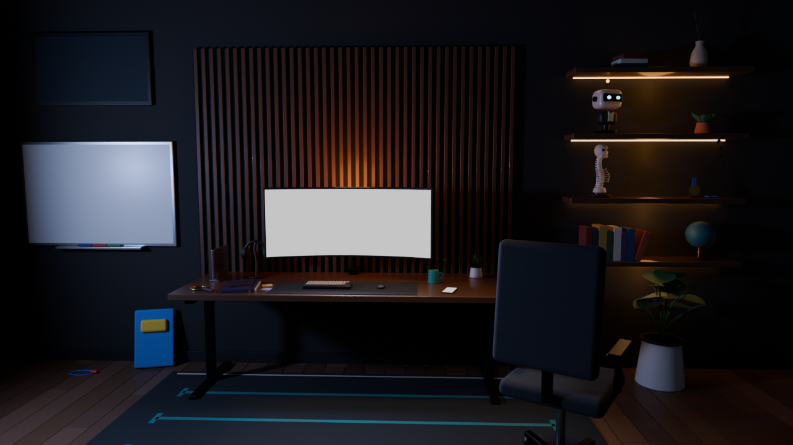

# Pokój Damiana: portfolio 3D

Interaktywne portfolio w formie pokoju ze stanowiskiem komputerowym. Każdy przedmiot to projekt albo cecha.
Po kliknięciu pojawia się opis i to, jakie umiejętności dany przedmiot pokazuje.
Wersja uniwersalna, do zgłoszeń w różnych branżach.
Część przedmiotów prowadzi do projektów na GitHub Pages.



## Jak to jest zbudowane

| Warstwa | Plik | Co robi |
|---|---|---|
| Modele i otoczenie | `blender/build_room.py` | Cała scena w Blenderze, z kodu (bpy). Eksport do `assets/models/room.glb` |
| Treści | `assets/js/content.js` | Teksty, linki i umiejętności przy przedmiotach, **tu edytujesz opisy** |
| Scena w przeglądarce | `assets/js/app.js` | Three.js: wczytuje GLB, nocne światło (monitor, LED-y), bloom, jedna kamera, klikanie |
| Interfejs | `index.html`, `assets/css/style.css` | Ekran powitalny, panel z opisem, spis rzeczy |
| Biblioteki | `assets/vendor/` | Three.js r160 (lokalnie, bez CDN) |

### Przedmioty i ich `id`

`chair`, `monitor`, `inkaso` (demo rozliczania wpłat), `anatomia` (link), `dashboard` (link do demo), `automations`, `jarvis` (link),
`priorytet` (link), `recorder`, `instagram` (link), `whiteboard`, `books`, `magnifier`, `swim`, `globe`,
`poster` (link), `plant`, `phone` (kontakt).

## Szybki przegląd (bez 3D)

Link do CV: `https://damianlapczynski.github.io/portfolio/?szybko`. Jedna strona z podsumowaniem, obszarami kompetencji
i projektami, przycisk „Zapisz jako PDF”. Treść: obiekt `QUICK` w `assets/js/content.js`, logika: `assets/js/quick.js`.

## Demo „Rozliczanie wpłat”

`projects/inkaso/`: React + TypeScript + SQLite w przeglądarce (sql.js). Dopasowanie wpłat z wyciągu do spraw
regułami SQL, weryfikacja, cofanie zmian, przypomnienia, podgląd webhooka. Dane fikcyjne.

```bash
cd projects/inkaso
npm install
npm test        # 13 testów logiki dopasowania
npm run build   # buduje do /inkaso (serwowane przez GitHub Pages)
```

## Zmiana tekstów i linków

Edytuj `assets/js/content.js` (pole `links` dla przycisków). Teksty na ekranie monitora, tablicy,
plakacie i grzbietach książek są rysowane w `assets/js/app.js` (obiekt `TEX`).

## Zmiana modeli (Blender)

```bash
pip install bpy           # albo użyj zainstalowanego Blendera
python blender/build_room.py            # eksport room.glb
python blender/build_room.py --render   # + podgląd Cycles do blender/preview.png
```

Z pełnym Blenderem: `blender -b -P blender/build_room.py -- --render`.
Nazwy obiektów `item_<id>` łączą model z opisem w `content.js`.

## Podgląd lokalny

Moduły ES nie działają z `file://`, więc potrzebny jest mały serwer:

```bash
python3 -m http.server 8000
```

Potem otwórz http://localhost:8000.

## Do uzupełnienia

- Rejestrator wykładów nie ma linku (repozytorium prywatne). Jeśli zrobisz publiczne demo, dopisz `links` w `content.js`.

## Publikacja (GitHub Pages)

Settings → Pages → Deploy from a branch → `main` / `(root)`.
Strona będzie pod `https://damianlapczynski.github.io/portfolio/`.
